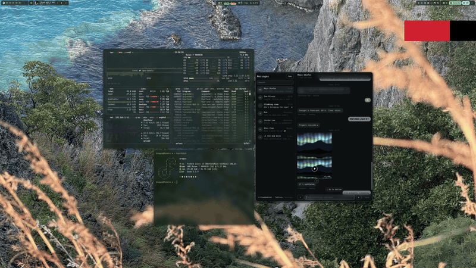

# Hyprdrive

Hyprdrive is a [Hyprland](https://hyprland.org) plugin that brings the best
parts of other desktops to Hyprland: a macOS- and GNOME-style overview of every
window, type-to-search, and a dock with live previews, all following your own
theme.



**Early access** for plain Hyprland 0.56, on any distro: download the
[latest release](https://github.com/dragosol/Hyprdrive/releases/latest) and
follow [Install](#install) below. It is in continuous development, so expect
regular updates; feedback and bug reports are welcome in the
[issues](https://github.com/dragosol/Hyprdrive/issues).

This branch (`hyprland-native`) runs on plain Hyprland and adds Mosaic, a
hybrid layout, alongside the overview, a full dock with stacks and search. On
[Omarchy](https://omarchy.org/) it notices Omarchy and integrates with it.

[Website](https://hyprdrive.shastasia.com) ·
[Demo film on YouTube](https://www.youtube.com/watch?v=RRkIViQvAOY) ·
[All config keys](docs/CONFIG.md)

> Built and tested against Hyprland **0.56.2** with a **Lua** config
> (`hyprland.lua`). Other Hyprland versions are not supported: the plugin
> refuses to load on an ABI mismatch, which shows up as `[he] Version mismatch`.

## What it does

### Overview

Tap Super (press and release, no other key), or swipe up with 3 fingers:


- A mission-control grid of real, compositor-rendered windows. On a trackpad it
  follows your fingers, and reversing mid-swipe undoes it. Hover a tile to lift
  it, click to go there, or close it with its X.
- **Search, calculate or run:** just start typing. Installed apps, open windows,
  files and GNOME search providers come up in one list, sums are worked out as
  you type, and a command can be run straight from the field.

  

- A **workspace strip**. Drag a tile onto a strip cell and the window moves
  there. Drop it on the empty cell and it gets a desktop of its own.

  

- **Hold to swap:** drag a window over another one and hold it there. Let go
  and the two trade places (`drag:hold_to_swap`, on by default). Works between
  windows of the same desktop in every layout, the Mosaic canvas included.
- Step through desktops with the scroll wheel, a trackpad swipe (with magnetic
  detents and a name pill on the card the swipe is settling on) or the
  keyboard.
- Several monitors act as one. The overview opens and closes on all of them,
  and Tab walks from the search to each monitor's grid.
- On a scrolling-layout desktop, the 3-finger swipe first scrolls that
  desktop's windows, then carries on into the next or previous desktop past
  either end.
- **Hot corner** (off by default): rest the pointer in a screen corner to open
  the overview, and again to close it. Pick the corner and the delay; an
  optional ripple runs across the screen.

### Desktops

- **Super+scroll** walks the desktops one per wheel notch, empty ones included
  (`binds:scroll_desktops`, modifier `binds:scroll_desktops_mods`; it replaces
  whatever had that chord, such as Omarchy's "scroll active workspace").
- **Push a window to the next desktop:** drag a window, file or folder to the
  left or right edge of the screen and hold it there (`drag:spring_edges`).
  Keep holding to keep going.
- Desktop changes made by a key and those made by focus moving to another
  desktop can each be made instant (`animation:desktop_keyboard`,
  `animation:desktop_focus`).

### Dock

- **Dash-to-Dock behaviour**, counted over the desktop you are on: launch,
  focus, cycle, whole-app minimize and restore, favourites, running dots,
  notification badges and autohide. It can stay on one monitor, list only the
  current desktop's apps, and make tiled windows shorten to clear it when it
  does not hide.
- **Live previews:** hover an icon to see its windows live. Several windows
  arrange in rows inside one rounded panel whose corners match your window
  rounding. Click a preview to go to that window.
- **Minimize and restore** fly into the icon and back out, motion-blurred.
- **Right-click** an app for its windows, its desktop actions and moving its
  windows to another desktop.
- **Stacks**, in the macOS style. A pinned folder shows its newest files as a
  pile. Click it and they fan out, or they open in a searchable grid when a fan
  would not fit. Space previews the hovered item through GNOME Sushi. Drop
  files onto a stack to move them in, or onto Trash. Drag files out of a fan
  into any app. A download in progress shows a progress bar. Downloads is
  pinned on first run. The fan can stand in a straight column instead of an
  arc (`dock:stack_fan_straight`, off by default).

  

- **Spring-loaded apps:** hold a dragged file over a running app or one of its
  previews, and the app comes forward for the drop (`drag:spring_dock`).
- **Mounted drives** and network shares (SMB, SFTP, NFS, WebDAV) as dock items,
  in the order you choose (off by default), and a Trash that shows when it has
  something in it.
- **Pulse busy apps** (off by default): an app's running dots pulse red while
  it, with the processes it started, uses more CPU than a threshold you set.
  Pick the colour in the settings (`dock:cpu_pulse`, `dock:cpu_pulse_threshold`,
  `dock:cpu_pulse_color`).
- **Your own icons:** give any app on the dock a different icon, from your icon
  theme, a file, or the selfh.st logo collection.
- **Feel:** icons tilt toward the pointer and lean into a press, urgent apps
  wiggle, and the frosted glass follows Hyprland's blur settings.
- **Genie minimize** is in, but broken for now: it is forced off and marked
  Broken in the settings.

### Mosaic

**Mosaic** (experimental, on by default) is a third layout beside Dwindle
and Scrolling, after GNOME's planned Mosaic. Each window keeps its own size,
and the windows gather in one tight cluster in the middle of the screen, with
no holes between them. Opening a window never resizes the others. When they no
longer fit, the desktop tiles them in Dwindle style, and it goes back to the
mosaic once they fit again. Each app's size is remembered.

- **Rearrange by dragging:** Super+drag a window and drop it. It lands on the
  side of the cluster you dropped it on, or in the middle when the others can
  close around it, and the other windows hold still until you let go.
- **Resize from any corner or edge** (Super+drag there, or a plain drag on a
  corner): the other windows hold still while you drag, in the cluster and in
  the tiles alike, and settle when you let go.
- **Keyboard:** set `mosaic:focus_binds` to a modifier (for example `SUPER`)
  for Mosaic-aware focus on the arrow keys; adding Shift swaps the focused
  window with its neighbour in that direction.
- **Switching:** Super+L cycles a desktop through Dwindle -> Scrolling ->
  Mosaic (`hyprdrive-layout-cycle`), and each desktop keeps its layout across a
  reload or a reboot. Desktops start in your usual layout; set `mosaic:default`
  to start new ones in Mosaic. Pick another chord with `mosaic:cycle_bind`
  (e.g. `"SUPER + M"`, or `"none"` to keep a Super+L of your own), or turn
  Mosaic off with `mosaic:enabled = false` or in the settings.
- **Infinite canvas** (off by default, `mosaic:infinite_canvas`): instead of
  tiling when the windows no longer fit, they keep their sizes and spill past
  the screen: still one tight mosaic cluster, only the gap between windows, on
  a canvas you pan across. Turning it off puts the desktop straight back in the
  mosaic (or its tiles).
  - **Focus pans smoothly** (`animation:canvas_curve`, the house curve by
    default, no bounce, over `animation:canvas_pan_ms`; both in Settings >
    Animation). A window focused off screen, or clicked, is brought fully into
    view and centred, keeping the window focus came from in view too when both
    fit, and a sliver of its neighbours where there is room. With the zoom
    choice below, hovering a window does the same. A window already in view
    does not move the canvas. The pointer moves with the canvas, so it stays on
    the same window.
  - **All directions** (`mosaic:canvas_directions = "all"`, the default): the
    canvas grows down as well as across.
  - **Horizontal** (`"horizontal"`): one strip. Swipe sideways with three
    fingers, or Super+scroll, to pan it; past the first or last window the same gesture switches desktops, as on a
    Scrolling desktop.
  - **Holding Super and moving the pointer** (`mosaic:canvas_super_move`):
    `"zoom"` (the default): every window shrinks onto the screen; hover one to focus
    it, click it or let go of Super to zoom back in on it, or press on one and
    drag it to rearrange the canvas while zoomed out. `"pan"` (All directions
    only): the pointer's place on the screen is your place on the canvas, so
    the top-left corner shows the top left of the canvas. Neither starts
    before the pointer has moved a little, and a Super+click or Super+drag
    does neither until Super is let go.
  - **Super+drag** works as in the mosaic: the window lands where you let go
    and the cluster packs around it. Resizing works there too, even zoomed out
    (press a window's corner or edge), and moving the mouse on past the
    screen's edge while resizing slides the view so the window keeps growing,
    only as far as you move. Push against the screen's edge while
    dragging to pan the canvas.

  In the overview, the desktop strip shows the whole canvas zoomed out.

It is best on large displays, and it is the part of Hyprdrive most likely to
have rough edges.

### Gestures and search tools

**Gestures:** the 3-finger up and down swipes are installed by `make install`.
Any other gesture can be bound with `hl.plugin.hyprdrive.gesture{...}`: the
overview, workspace or all-workspace swipes, scratchpad show and hide, a
one-way fullscreen, a close with a way back, a keyboard chord and more. Two
behaviours are on by default:

- `gestures:keep_swipe`: a swipe keeps going while one of the fingers that
  started it is still down.
- `gestures:swipe_while_dragging`: with one finger holding a drag, three more
  fingers can still swipe desktops.

Both read the touchpad's own multitouch slots. This needs the session's normal
read access to the touchpad device, and without it they quietly fall back to
libinput's behaviour.

**Search tools** (opt-in, see [Network use](#network-use)): `define <word>`
looks a word up in a dictionary, and `tr <lang> <text>` translates.

**Motion and animation:** one curve and one speed drive everything Hyprdrive
animates, and motion blur can be set per animation (window moves, desktop
switches, the overview, the dock) or turned off.

## Requirements

- **Hyprland 0.56** (built against 0.56.2) with a **Lua config**,
  `~/.config/hypr/hyprland.lua`. With a hyprlang `hyprland.conf` the plugin
  still loads, and both tap-Super and the dock work. The installed fragments
  (the overview's click submap, the 3-finger gestures, the settings rules) are
  Lua, though, so nothing loads them; `make install` says so and suggests what
  to do.
- **To build:** a C++23 compiler with `#embed` (GCC 15+ or Clang 19+), `make`
  and `pkg-config`. You also need the development files for Hyprland 0.56
  (its headers come with the Hyprland package on most distros), pixman,
  libdrm, pango/cairo, fontconfig, libinput, libudev, wayland-server,
  xkbcommon, libsystemd, gio and Lua 5.4.
- **Optional at runtime:**
  - Quickshell (`qs`) 0.3 and Python 3, for the settings app
  - an icon font such as a Nerd Font. Without one, the plugin draws its own
    built-in glyphs.
  - GNOME Sushi, for Space-to-preview in stacks
  - `curl` and `jq`, for the search tools
  - `ffmpeg`, for the search easter egg

## Install

The plugin is compiled against the Hyprland on your machine, so it is built
locally rather than downloaded.

### From source (recommended)

```bash
git clone -b hyprland-native https://github.com/dragosol/Hyprdrive.git ~/Projects/Hyprdrive
cd ~/Projects/Hyprdrive
make install PREFIX=~/.local
hyprctl plugin load ~/.local/lib/hyprdrive/hyprdrive.so
hyprctl reload
hyprctl configerrors
```

`make install` builds the plugin and runs the checks (`make check`: a symbol
check and the host tests). It then installs:

- `hyprdrive.so` in `$PREFIX/lib/hyprdrive/`
- the `hyprdrive-integration` CLI in `$PREFIX/bin/`
- the Lua fragments in `~/.config/hypr/hyprdrive/`, with their loader, and
  one `require` line at the end of `~/.config/hypr/hyprland.lua`
- the settings: the standalone app on plain Hyprland, or the bar panel on
  Omarchy (see below)

`PREFIX` defaults to `~/.local`. Wherever it points, the loader is written to
find the `.so` there.

`hl.plugin.load` in the loader only runs when the config is parsed, and a
`hyprctl reload` does not repeat it. So the first session needs the explicit
`hyprctl plugin load` above (or a log-out and back in). From then on the
fragment loads it at every login.

**Updating:** run `hyprdrive update`. It looks up the newest release, asks
before changing anything, then checks that release out in your checkout,
runs `make install` and reloads the plugin. The settings show **Update
available!** beside the version when there is one; clicking it runs the same
update in your terminal. `hyprdrive update --check` only reports. By hand:
`git pull`, then `make install` again, then log out and back in.
After a Hyprland update the plugin may refuse to load with
`[he] Version mismatch`. Rebuild from scratch with `make clean && make install`.

**Removal:** run `make uninstall` from the checkout. It removes the plugin, the
loader and the `require` line (a backup of `hyprland.lua` is kept). It moves
the fragments aside rather than deleting them, because they may hold your own
edits. Your saved state in `~/.local/state/hyprdrive` (favourites, stacks,
Mosaic sizes) is kept.

### With hyprpm

```bash
hyprpm add https://github.com/dragosol/Hyprdrive origin/hyprland-native
hyprpm enable hyprdrive
hyprpm reload
```

Write the branch as `origin/hyprland-native`. hyprpm's optional second
argument is a git revision, not a branch: it clones the repository's default
branch and then runs `git reset --hard <rev>`. In a fresh clone only the
default branch exists locally, so a bare `hyprland-native` fails with "Could
not check out revision". `hyprpm update` clones again and resets to the same
revision, so `origin/hyprland-native` keeps following the branch.

hyprpm builds and loads only the `.so`. Tap-Super, the dock, the search and
stacks all work from that alone. What hyprpm cannot install:

- **The Lua fragments.** Without them there are no 3-finger gestures and no
  click-to-pick submap. You can bind them yourself with
  `hl.plugin.hyprdrive.gesture{...}`, or run `make install` from a checkout
  as well. The fragments find hyprpm's build in
  `/var/cache/hyprpm/$USER/Hyprdrive/` and do not load it twice.
- **The settings app.** It lives in `settings/`, which you can run from a
  checkout as `settings/hyprdrive-settings`.
- **The `hyprdrive-integration` CLI.**

hyprpm also needs `hyprpm reload` in your autostart to load the plugin at
login.

## Settings

Every option has a row in the settings: one animation curve and speed for
everything, per-animation motion blur, a trackpad gesture editor, dock and
overview options, Mosaic, dock icons, a Keybinds section that shows every
Hyprdrive bind as it is bound right now (and lets you change it), and
AC/battery performance profiles. The
same keys are plain Lua in `~/.config/hypr/hyprdrive/` if you would rather edit
files.

- **Plain Hyprland: `hyprdrive-settings`**, a standalone Quickshell window
  (needs `qs` 0.3). Run it, or bind it:

  ```lua
  if hl.plugin.hyprdrive then
    hl.bind("SUPER + COMMA", hl.plugin.hyprdrive.settings())
    hl.bind("SUPER + SHIFT + COMMA", hl.plugin.hyprdrive.settings("pane dock"))
  end
  ```

  `hyprdrive-settings --pane ID` opens one section, and `--icons APPID` opens
  the icon picker for one app. Colours come from Hyprdrive's own palette, so
  the window matches the dock and follows theme reloads. The app is new in
  this branch; tell us what breaks.
- **Omarchy:** the settings are a panel in Omarchy's bar instead
  (`dragos.hyprdrive`), and `hyprdrive-settings` hands over to it.

## Omarchy integration

Hyprdrive decides once per session, and again on every config reload, whether
this is an Omarchy desktop. On Omarchy it:

- installs the bar panel instead of the standalone settings app
- adds Omarchy's menu as a column in the search and launches terminal agents
  through `omarchy-launch-tui`
- takes its colours from the Omarchy theme's `colors.toml`
- gives Mosaic Super+L

Elsewhere none of that exists, and nothing under `~/.config/omarchy` is
created.

**Auto-detection** needs two things: an Omarchy install, and Omarchy's state
directory `~/.local/state/omarchy/current`. Any one of these counts as an
install:

- `omarchy` is on `PATH`
- `~/.local/share/omarchy/bin/omarchy` exists
- `$OMARCHY_PATH` is set

Either half on its own is not enough. A home directory carried over from an
Omarchy machine, or a stray `omarchy` script, does not make a desktop Omarchy.

**Overrides**, strongest first:

| how | effect |
| --- | --- |
| `HYPRDRIVE_NO_OMARCHY=1` in Hyprland's environment | never Omarchy, whatever else says so |
| `HYPRDRIVE_INTEGRATION=omarchy\|none\|auto` | per session (a test run, a nested instance) |
| `plugin:hyprdrive:integration = "omarchy" \| "none" \| "auto"` | the standing preference, in your config |
| auto | the detection above |

To see the answer and why: `hyprctl hyprdrive-integration` asks the running
plugin, and `hyprdrive-integration --why` works without a compositor (it is
what `make install` asks). Force a plain install on a machine that has
Omarchy files with `HYPRDRIVE_NO_OMARCHY=1 make install`.

## Theming


Hyprdrive ships no colours of its own. Rounding, blur, shadows and the
selection colour come from Hyprland's live values (`decoration:*`,
`general:col.active_border`). The palette (background, text, accent, selection
and so on) is resolved in this order:

1. the `theme:*` keys, if you set them
2. `theme:palette_file`: a colors.toml-style file, a pywal `colors.json` or
   matugen JSON
3. Omarchy's `colors.toml`, on Omarchy
4. values derived from Hyprland's own

The glass of the dock, the search and the strip is tinted with
`dock:background_color` / `dock:background_opacity` if you set them, otherwise
with your theme's background, otherwise with your Ghostty terminal's background
and opacity.

Change your theme and reload, and Hyprdrive follows.

## Configuration

All keys are in **[docs/CONFIG.md](docs/CONFIG.md)**, which is generated from
`Config.cpp`, so it is always complete. Everything lives under
`plugin:hyprdrive:`, for example:

```lua
hl.config({ plugin = { hyprdrive = { hot_corner = { enabled = true }, dock = { autohide = false } } } })
```

The fragments in `~/.config/hypr/hyprdrive/` load in filename order. Each one
has a machine-owned half, which is rewritten on reinstall, and a raw-snippet
block below `BEGIN raw-snippet`, which is yours. Lua's last assignment wins, so
a line there overrides the generated one above it.

**Dispatchers** (`hl.plugin.hyprdrive.<name>(arg)` in Lua,
`hyprdrive:<name>` in hyprlang):

| dispatcher | argument | what it does |
| --- | --- | --- |
| `overview` | `toggle`/`open`/`close` `[monitor\|all]`, `select`, `tab` | open, close, or commit the overview |
| `navigate` | `left`, `right`, `up`, `down` | move the selection |
| `window` | `select`, `close`, `click` | act on the overview window under the cursor |
| `minimize` | `window`, `restore` | minimize into the dock, or restore |
| `hotkey` | `overlay`, `1`-`10` (optionally `shift`/`ctrl`) | dock slot accelerators (unbound by default) |
| `stack` | `pin`/`unpin`/`toggle`/`open <path>`, `view`, `sort`, `clear`, ... | dock stacks |
| `focus` | `l`, `r`, `u`, `d` | Mosaic-aware focus by direction |
| `swap` | `l`, `r`, `u`, `d` | Mosaic-aware swap with the neighbour in that direction (Hyprland's own swap elsewhere) |
| `gesture` | a gesture spec | bind a trackpad gesture to a Hyprdrive action (see Gestures) |
| `desktop` | `next`, `prev` | the next / previous desktop by number, empty ones included (Super+scroll, `binds:scroll_desktops`) |
| `settings` | `open`, `toggle`, `close`, `pane <id>`, `icons <app>` | open the settings |
| `debug` | `frames`, `mem`, `gesture <script>`, ... | diagnostics and test hooks, see [docs/DEBUG.md](docs/DEBUG.md) |

```lua
-- Guarded: if the plugin is unloaded or fails to load, hl.plugin.hyprdrive is
-- nil, and an unguarded line would stop Hyprland registering ANY of your binds.
if hl.plugin.hyprdrive then
  hl.bind("SUPER + TAB", hl.plugin.hyprdrive.overview("toggle all"))
  hl.bind("SUPER + H", hl.plugin.hyprdrive.minimize("window"))
end
```

## Network use

Hyprdrive only goes online for the four features below. The native install
switches the two search tools on, but they send nothing until you type
`define` or `tr`; the icon download only runs when you open it in the settings.
Turn the search tools off in Settings > Overview > Search.

| setting | sends | to |
| --- | --- | --- |
| `search:dictionary = true` | the word after `define` | `en.wiktionary.org` |
| `search:translate = true` | the text after `tr` | `api.mymemory.translated.net`, or your own `search:translate_endpoint` (e.g. LibreTranslate) |
| settings -> Icons -> selfh.st | nothing you type; downloads the logo index once a day and the logos you pick | `cdn.jsdelivr.net` |
| the settings' update check (on; `hyprdrive update --never-check` turns it off) | nothing about you; asks for the latest release at most every 6 hours, only while the settings are open | `api.github.com` |

`hyprdrive update` also fetches the repository with `git` when you install
an update. The update check follows no redirects and caps every response.

The search tools run `curl` off the compositor thread. Your text is passed as
an argument, never through a shell.

## Honest notes

- **Hyprland 0.56.2 only.** Each Hyprland release changes the plugin ABI, and
  a new one needs a rebuild at the least, maybe a port.
- **Mosaic is experimental**, and so is the standalone settings app.
- **Genie minimize is broken** for now, so it stays off whatever the setting
  says.
- **hyprlang configs are second-class.** The plugin works, but the shipped
  binds and gestures are Lua fragments.
- **Trackpad features** were developed on one machine's touchpad. The headless
  test harness drives gestures synthetically (`hyprdrive:debug gesture`,
  [docs/DEBUG.md](docs/DEBUG.md)), so their logic is covered, but your
  libinput settings may still feel different.
- This is a compositor plugin. A bug in it can take the session down rather
  than just an app. `make install` refuses to install a build whose symbol
  check failed; please report crashes with the `coredumpctl` backtrace.

## Credits

- **Vaxry** and the [hyprland-plugins](https://github.com/hyprwm/hyprland-plugins)
  contributors. This repository is a fork of that tree, and Hyprland's plugin
  API is what makes any of this possible (BSD-3-Clause, see `LICENSE`).
- **yayuuu**, whose `scrolloverview` plugin Hyprdrive grew from. Old configs
  that use the `scrolloverview` names still load for one release.
- **dragos**: Hyprdrive itself, the dock, stacks, Mosaic and the Omarchy
  integration.

Contributing: [CONTRIBUTING.md](CONTRIBUTING.md). The rules there are short
and every one of them is a crash that already happened.
